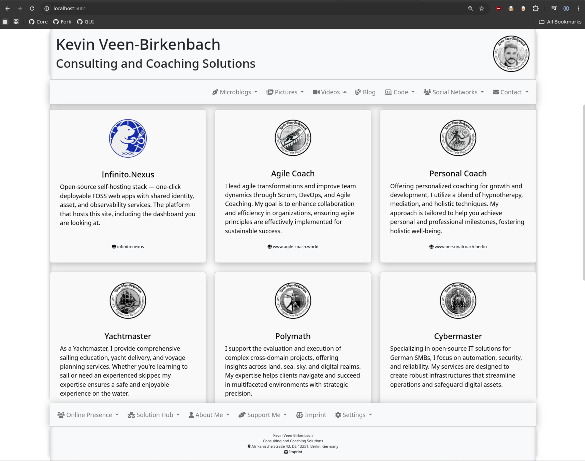

# PortUI 🖥️✨

[](https://github.com/sponsors/kevinveenbirkenbach) [](https://www.patreon.com/c/kevinveenbirkenbach) [](https://buymeacoffee.com/kevinveenbirkenbach) [](https://s.veen.world/paypaldonate)

A lightweight, Docker-powered portfolio/landing-page generator—fully customizable via YAML! Showcase your projects, skills, and online presence in minutes.  



> 🚀 You can also pair PortUI with JavaScript for sleek, web-based desktop-style interfaces.  
> 💻 Example in action: [CyMaIS.Cloud](https://cymais.cloud/) (demo)  
> 🌐 Another live example: [veen.world](https://www.veen.world/) (Kevin’s personal site)

---

## ✨ Key Features

- **Dynamic Navigation**  
  Create dropdowns & nested menus with ease.  
- **Customizable Cards**  
  Highlight skills, projects, or services—with icons, titles, and links.  
- **Smart Cache Management**  
  Auto-cache assets for lightning-fast loading.  
- **Responsive Design**  
  Built on Bootstrap; looks great on desktop, tablet & mobile.  
- **184 Languages**  
  Every ISO 639-1 code, browser-negotiated, RTL-aware, with machine translation for your own content.  
- **YAML-Driven**  
  All content & structure defined in a simple `config.yaml`.  
- **CLI Control**  
  Manage Docker containers via the `portfolio` command.

---

## 🌐 Quick Access

- **Local Preview:**  
  [http://127.0.0.1:5000](http://127.0.0.1:5000)

---

## 🏁 Getting Started

### 🔧 Prerequisites

- Docker & Docker Compose  
- Basic Python & YAML knowledge  

### 🛠️ Installation via Git

1. **Clone & enter repo**  
   ```bash
   git clone <repository_url>
   cd <repository_directory>
   ```

2. **Configure**
   Copy `config.sample.yaml` → `config.yaml` & customize.
3. **Build & run**

   ```bash
   docker-compose up --build
   ```
4. **Browse**
   Open [http://localhost:5000](http://localhost:5000)

### 📦 Installation via Kevin’s Package Manager

```bash
pkgmgr install portui
```

Once installed, the `portui` CLI is available system-wide.

---

## 🖥️ CLI Commands

```bash
portui --help
```

* `build` Build the Docker image
* `up` Start containers (with build)
* `down` Stop & remove containers
* `run-dev` Dev mode (hot-reload)
* `run-prod` Production mode
* `logs` View container logs
* `dev` Docker-Compose dev environment
* `prod` Docker-Compose prod environment
* `cleanup` Prune stopped containers

---

## 🔧 YAML Configuration Guide

Define your site’s structure in `config.yaml`:

```yaml
accounts:
  name: Online Accounts
  description: Discover my online presence.
  icon:
    class: fa-solid fa-users
  children:
    - name: Channels
      description: Platforms where I share content.
      icon:
        class: fas fa-newspaper
      children:
        - name: Mastodon
          description: Follow me on Mastodon.
          icon:
            class: fa-brands fa-mastodon
          url: https://microblog.veen.world/@kevinveenbirkenbach
          identifier: "@kevinveenbirkenbach@microblog.veen.world"
  cards:
    - icon:
        source: https://cloud.veen.world/s/logo_agile_coach_512x512/download
      title: Agile Coach
      text: I lead agile transformations and improve team dynamics through Scrum and Agile Coaching.
      url: https://www.agile-coach.world
      link_text: www.agile-coach.world

company:
  title: Kevin Veen-Birkenbach
  subtitle: Consulting & Coaching Solutions
  logo:
    source: https://cloud.veen.world/s/logo_face_512x512/download
  favicon:
    source: https://cloud.veen.world/s/veen_world_favicon/download
  address:
    street: Afrikanische Straße 43
    postal_code: DE-13351
    city: Berlin
    country: Germany
  imprint_url: https://s.veen.world/imprint
```

* **`children`** enables multi-level menus.
* **`link`** references other YAML paths to avoid duplication.

### 🗂️ Application dashboard (optional)

Add a top-level `dashboard` section to turn the card grid into an application
dashboard. Without it the page renders exactly as before.

```yaml
dashboard:
  folders:                       # optional: folder view; omit for the flat grid
    - slug: communication        # [a-z0-9-], used in ?folder=communication/chat
      name: Communication        # translated through the content catalogue
      description: Chat and mail # translated
      icon: {class: fa-solid fa-comments}
      children:
        - slug: chat
          name: Chat
  new_days: 14                   # optional: "New" badge window for card.added
cards:
  - title: Matrix                # the existing card keys stay as they are
    id: web-app-matrix           # stable id: favourites, recent list, chips
    tags: [chat, element]        # searchable, never translated
    folders: [communication/chat]  # one or more folder paths
    added: "2026-11-01"          # optional: shows "New" for new_days
```

With the section present the page gains:

* a search field in the header bar (`/` or `Ctrl+K`), live across all folders,
  matching title, text, tags and folder names in the page language and in
  English, tolerant of one typo in words of five or more letters; `↑`/`↓`,
  `Enter` and `Esc` drive the picker, `?q=` holds a committed search;
* with `folders`: folder tiles with application counts, a breadcrumb, back and
  forward buttons and `?folder=<slug>/<slug>`; folders without applications
  are hidden, cards without `folders` stay at the top level;
* a star per card (`id` required) for a Favourites row, a Recently used row and
  a tile/list toggle, all kept in `localStorage`;
* a chip slot in the bottom corner of every card with an `id`, filled by the
  host page through the chip API below.

#### Chip API

The dashboard scripts define `window.portui.chips` synchronously and then
dispatch `portui:ready` on `document`. Chips are kept per card id and are
redrawn into every place the card shows: its tile, the Favourites and Recently
used rows, the list view and the search picker.

```js
document.addEventListener('portui:ready', () => {
  window.portui.chips.set('web-app-matrix', [
    { kind: 'lock', tone: 'primary', icon: 'fa-solid fa-lock',
      label: 'Request access', href: 'https://access.example.org/?application=web-app-matrix',
      newTab: true, state: 'request' },
    { kind: 'health', tone: 'info', icon: 'fa-solid fa-circle-pause',
      label: 'Paused', detail: ' · 13:05', state: 'paused' },
  ]);
});
window.portui.chips.clear('web-app-matrix');
```

| Field | Required | Effect |
| --- | --- | --- |
| `kind` | yes | `[a-z0-9-]+`; the chip gets `portui-chip portui-chip-<kind>` |
| `tone` | yes | `primary`, `success`, `info`, `warning`, `danger` or `secondary` (`text-bg-<tone>`) |
| `label` | yes | tooltip and accessible name, translated through the interface catalogue when it holds the string |
| `detail` | no | appended to the label untranslated |
| `icon` | no | Font Awesome classes |
| `href` | no | renders a link (unsafe schemes are dropped); without it a `<button type="button">` |
| `newTab` | no | opens `href` in a new tab |
| `state` | no | written to `data-portui-state` |

`set(id, [])` and `clear(id)` remove the chips of a card. Invalid input throws a
`TypeError`. Clicking a chip never opens the application, and port-ui neither
stops nor prevents chip clicks, so the host page can listen for them on
`document`. Without a caller no chips show. The catalogues translate
`Sign in`, `Request access`, `No access`, `Running`, `Paused`, `Degraded`,
`Down` and `Unknown`.

#### Frame and shadows

The header and footer are wrapped in `.portui-frame-top` and
`.portui-frame-bottom`. Set `--portui-frame-border` for their side borders and
`--portui-frame-radius` (default `12px`) for their inner corners, which square
off where a card meets them. `--portui-shadow-frame`, `--portui-shadow-card`,
`--portui-shadow-card-hover` and `--portui-shadow-popup` set the shadows of the
frames, the cards at rest and on hover, and the menus and search picker.

---

## 🌍 Languages

Every ISO 639-1 language — all 184 two-letter codes — has a URL, a display
name in its own script and a writing direction. The interface ships translated
for 29 of them; the rest fall back to English string by string until a
catalogue is filled. `/` serves the best match for the visitor's
`Accept-Language` header, `/<code>/` forces one, and a switcher in the navbar
lists them all. The ten right-to-left languages get `dir="rtl"` and Bootstrap's RTL
stylesheet automatically.

Translations live in two catalogues, both keyed by the English source string:

| Path | Tracked | Holds |
| --- | --- | --- |
| `app/i18n/ui/<code>.yaml` | yes | Interface strings. Shipped for 29 languages; English is the source and has no file. |
| `app/i18n/content/<code>.yaml` | no | Your `config.yaml` prose, generated per deployment. |

A string with no catalogue entry falls back to English, so a half-filled
catalogue degrades instead of breaking.

Fill the content catalogues from a [LibreTranslate](https://libretranslate.com/)
instance — set `LIBRETRANSLATE_URL` in `.env`, then:

```bash
make i18n
```

This fills the interface strings of the languages that ship no catalogue as
well. Existing entries are never overwritten, and a string the shipped
catalogue already covers is never requested, so corrections you make by hand
survive later runs.

`name`, `title`, `description`, `text`, `warning`, `info` and `subtitel` are
translated; `url`, `link_text`, `identifier` and icon classes never are.

A machine cannot tell the menu label "Pictures" from the brand "Mastodon", so
list the brands in `app/i18n/keep.txt`, one per line — they are then stored as
themselves in every language and cost no request:

```
# Strings utils/i18n_sync.py stores as themselves instead of translating.
Mastodon
Nextcloud
freelancermap.de
```

Add one-off entries with `--keep Foo Bar`, or point somewhere else with
`--keep-file`. A protected string never replaces an entry you already wrote by
hand.

---

## 🚢 Production Deployment

* Use a reverse proxy (NGINX/Apache).
* Secure with SSL/TLS.
* Swap to a production database if needed.

Because every page carries a canonical URL and 184 `hreflang` alternates, two
details of the proxy setup now matter:

* **Set `TRUSTED_HOSTS`** in `.env` to your public hostname(s), comma-separated.
  Left empty, the app reflects whatever `Host` header arrives into its canonical,
  `hreflang` and redirect URLs — so a shared cache in front of it can be made to
  store a redirect pointing somewhere else.
* **Have the proxy send `X-Forwarded-Proto`.** Without it the app cannot know TLS
  terminated upstream and every canonical URL claims `http://`. `X-Forwarded-Host`
  is deliberately *not* trusted; set `Host` to the public name instead.

---

## 📜 License

Licensed under **GNU AGPLv3**. See [LICENSE](./LICENSE) for details.

---

## ✍️ Author

Created by [Kevin Veen-Birkenbach](https://www.veen.world/)

Enjoy building your portfolio! 🌟
